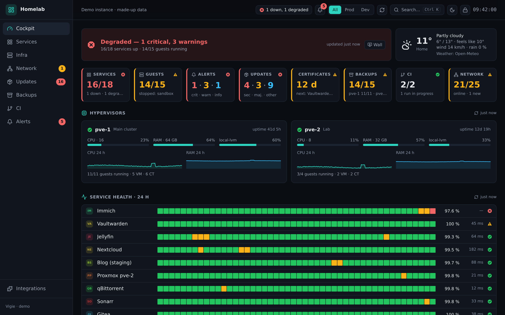
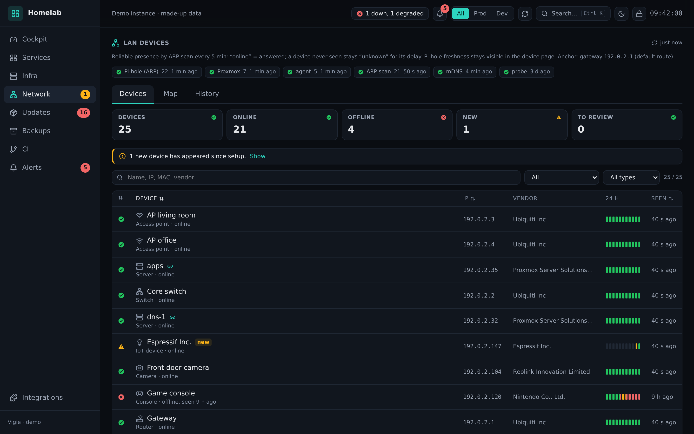
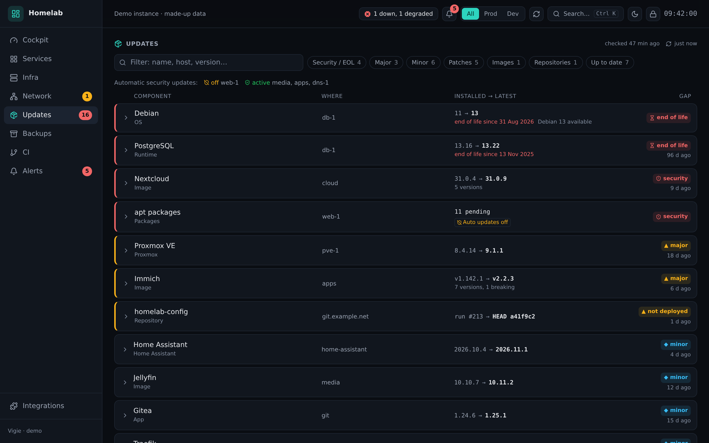
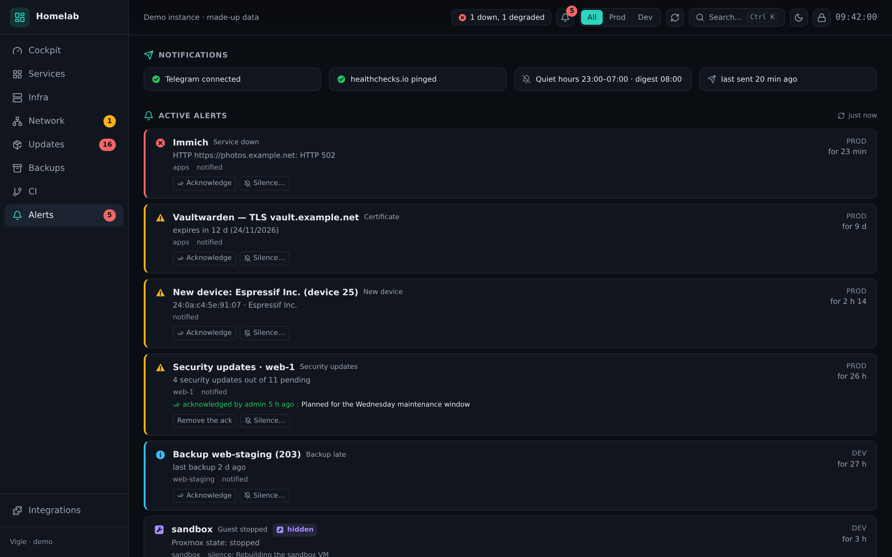
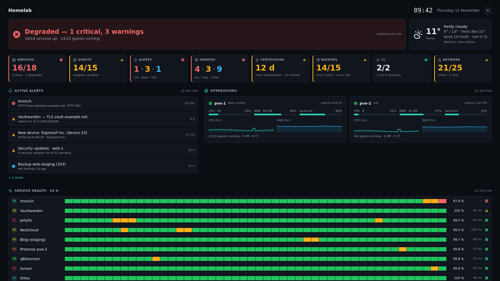

# Vigie

**One self-hosted page that tells you whether your homelab is healthy: services, Proxmox, hosts,
network, updates and alerts, with safe defaults and no external service required.**

Vigie probes your services, reads your Proxmox clusters and a small agent on your hosts, keeps an
inventory of the devices on your network, tracks the versions you run, and alerts you on Telegram
(or ntfy) when something needs you. It is mostly read-only: it never changes the systems it watches.

| | |
|---|---|
|  |  |
|  |  |



*Screenshots taken on demo data ([`scripts/screenshots/`](scripts/screenshots/capture.mjs)), every
name and address is made up.*

## Features

- **Services**: HTTP, TCP, TLS certificate and DNS probes, uptime history (24 h to 90 days),
  latency, widgets that read the API of your apps (Pi-hole, qBittorrent, any JSON endpoint),
  bookmarks and favorites.
- **Proxmox**: nodes, guests, storage, SMART and disk wear, failed tasks, backups (schedule, 7-day
  matrix, guests outside any job, orphaned archives), per-guest charts.
- **Hosts**: the `dash-report` agent (shell, over SSH or local) reports file systems, Docker
  containers, systemd units, pending apt updates, automatic security updates, reboot needed,
  SSH and firewall posture, listening ports.
- **Network**: device inventory from ARP scans, DHCP leases, Pi-hole, Proxmox and mDNS, presence
  history, a topology map, alerts for new devices and new MAC addresses, an optional service probe.
- **Updates**: installed versus latest versions (GitHub, Docker registries, PyPI, Gitea,
  endoflife.date, apt), security fixes, end-of-life dates, decisions to ignore or postpone.
- **Alerts**: rules with grace periods, dependencies and quiet hours, Telegram messages with
  buttons, a daily digest, acknowledgements and silences with a reason, an interactive bot,
  ntfy as a second channel.
- **Wall mode** for a dedicated screen, English and French interface, light and dark themes.
- **Plugins**: an internal plugin interface (Gitea CI and runners, ntfy, and an example).

## Integrations

| Source | What Vigie reads | Configuration |
|---|---|---|
| Proxmox VE | nodes, guests, storage, disks, tasks, backups | read-only API token (`PVEAuditor`), pinned CA |
| `dash-report` agent | hosts and Docker | SSH key or local timer, see [docs/agent.md](docs/agent.md) |
| Pi-hole | DHCP leases, network devices, widgets | API password |
| Gitea | repository activity, CI runs, runners (plugin) | read token |
| Telegram | alerts, digest, bot | bot token and chat id |
| ntfy | second notification channel (plugin) | topic and optional token |
| Open-Meteo | weather on the cockpit (optional) | latitude and longitude |
| GitHub, Docker Hub, PyPI, endoflife.date | latest versions | optional GitHub token |

## Security model

```
            browser
               │  session cookie (HttpOnly, SameSite=Strict; Secure over HTTPS)
               ▼
   ┌───────────────────────── Vigie server ─────────────────────────┐
   │ listens on 127.0.0.1 by default (put an HTTPS reverse proxy    │
   │ in front, or set listenHost)                                   │
   │ Host header checked (allowedHosts), else 421                   │
   │ reading the API requires a session (security.anonymousRead)    │
   │ admin login from the loopback only (security.adminCidrs),      │
   │   never over plain HTTP from elsewhere (security.httpLogin)    │
   │ writes: session + same Origin, audit log; most need a reason   │
   │ tokens stay on the server (environment file, mode 0600)        │
   └────────────────────────────────────────────────────────────────┘
               │ read-only tokens, pinned CAs
               ▼
     Proxmox · agents over SSH · Pi-hole · Gitea · Telegram · ntfy
```

Every relaxation is an explicit setting. Details: [docs/security.md](docs/security.md).

## Install

### With Docker Compose

```bash
git clone https://github.com/HiteaFR/vigie.git && cd vigie
docker compose build
docker compose run --rm init      # setup wizard: title, language, admin password, Proxmox, Gitea
docker compose up -d
```

Then open `http://127.0.0.1:8088` on the Docker host. Without a configuration the service still
starts, in a "setup needed" mode, and its log tells you to run `init`. More: [docs/docker.md](docs/docker.md).

### Manually (Node 22, systemd)

```bash
cd client && npm ci && npm run build && cd ..
cd server && npm ci --omit=dev
npm run init -- --config /etc/vigie/config.json --env /etc/vigie/vigie.env --pki /etc/vigie/pki --state /var/lib/vigie
```

Then install the unit from [`deploy/vigie.service.example`](deploy/vigie.service.example) and start
it. More: [docs/installation.md](docs/installation.md).

## Documentation

- [Installation](docs/installation.md) and [Docker](docs/docker.md)
- [Configuration](docs/configuration.md): every key, environment variables, examples
- [Security](docs/security.md)
- [Features](docs/features.md): views, history, widgets; [icons](docs/icons.md)
- [Proxmox](docs/proxmox.md), [agent](docs/agent.md), [network](docs/network.md), [updates](docs/updates.md)
- [Alerts, Telegram and the bot](docs/alerts.md)
- [Deployment](docs/deployment.md)
- [Development](docs/development.md) and [writing a plugin](docs/plugins.md)

### Plugins and integrations

Gitea (repository activity, runners, CI) and ntfy (a second notification channel) are plugins;
network and versions are core modules loaded by the same host. Each plugin has its
`plugins.<id>` block in `config.json` and its secrets in the environment file; without a block, a
plugin reads and sends nothing. The **Integrations** page (`/integrations`) shows each module and
plugin, read-only: active, not configured, or failing with its last (masked) error. The same
content is served by `GET /api/plugins`. Writing a plugin: see the guide
[docs/plugins.md](docs/plugins.md). The plugin interface is version 0: internal and unstable.

## Contributing, security, license

Contributions are welcome: see [CONTRIBUTING.md](CONTRIBUTING.md) (commits signed off under the
DCO) and the [code of conduct](CODE_OF_CONDUCT.md). Report vulnerabilities privately: see
[SECURITY.md](SECURITY.md).

Vigie is licensed under the [Apache License 2.0](LICENSE). Third-party notices: [NOTICE](NOTICE).
